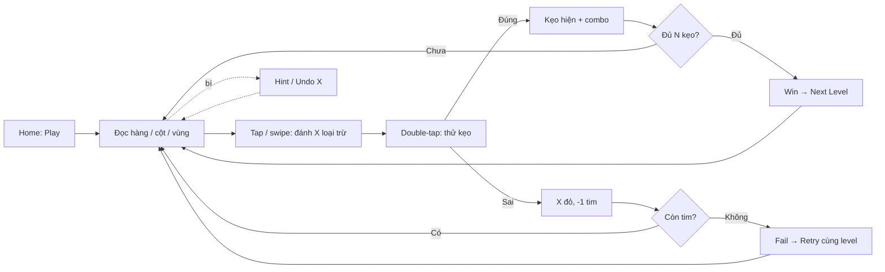
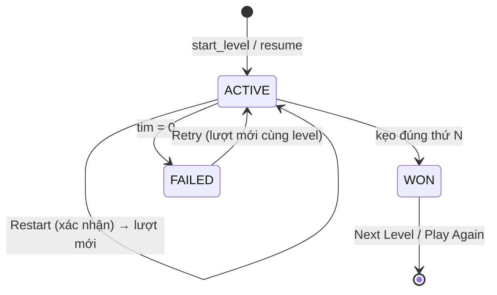

# GDD-02 — Core Gameplay

| Thuộc tính | Giá trị |
| --- | --- |
| Dự án | CanDoKu |
| Mã tài liệu | GDD-02 |
| Phiên bản | 1.0.0 |
| Trạng thái | Approved · Living document |
| Cập nhật | 2026-10-14 |
| Phụ trách | Game Design |
| Liên quan | [GDD-01](01-game-overview.md), [GDD-03](03-game-systems.md), [GDD-04](04-ux-ui.md), [GDD-05](05-level-design.md), [GDD-08](08-technical-design.md), [GDD-10](10-reasoning-techniques.md) |

> **Tóm tắt:** Chương chốt luật bàn chơi (GR-01..05), bốn trạng thái ô, điều khiển tap / double-tap / swipe, tim và lỗi, điều kiện thắng/thua và state machine của một lượt. Hint, Undo, Combo và tiến trình campaign được đặc tả ở [GDD-03](03-game-systems.md).

## 1. Mục đích và phạm vi

Đặc tả hành vi đích của một lượt chơi (session) trên một level, đúng với code hiện hành trong `game/scripts/core/` và `game/scripts/input/`. Không bao gồm UI layout (GDD-04) hay dữ liệu level (GDD-05).

## 2. Core loop

**Design intent:** vòng lặp micro (đọc → loại trừ → thử) diễn ra vài giây; vòng macro (level → level) vài phút. Phần thưởng chính là khoảnh khắc "à ra thế" khi một viên kẹo được suy luận chắc chắn, được khuếch đại bằng combo ([GDD-03 §4](03-game-systems.md#4-combo)).

## 3. Bàn chơi và luật

Bàn N×N (N = 4–12) chia thành N vùng màu liên thông. Lời giải đặt đúng N viên kẹo.

| ID | Yêu cầu | Tiêu chí kiểm |
| --- | --- | --- |
| GR-01 | Mỗi hàng có đúng một kẹo | `solution` có N phần tử, mỗi phần tử là cột của kẹo trên hàng đó |
| GR-02 | Mỗi cột có đúng một kẹo | `solution` là hoán vị của `0..N-1` |
| GR-03 | Mỗi vùng có đúng một kẹo | Nhãn vùng của N ô nghiệm đôi một khác nhau |
| GR-04 | Hai kẹo không chạm nhau, kể cả chéo | Với mọi hàng kề: `abs(solution[r] - solution[r+1]) > 1` |
| GR-05 | Level có đúng một nghiệm, bàn khởi đầu trống | Solver độc lập dừng ở nghiệm thứ hai, nghiệm duy nhất khớp JSON; `givens` rỗng (validator từ chối nếu khác) |
| GR-07 | Level campaign có trace suy luận hợp lệ đến đủ N kẹo theo profile độ khó | Kiểm trong pipeline nội dung, xem [GDD-05](05-level-design.md) và [GDD-11](11-level-generation.md) |
| GR-08 | X (MARK) và X đỏ (ERROR) là ghi chú của bàn; không ràng buộc solver, Hint hay điều kiện thắng | Thắng chỉ phụ thuộc số kẹo đúng |

## 4. Trạng thái ô

Nguồn: `core/cell_model.gd` — `enum CellKind { BLANK=0, MARK=1, CANDY=2, ERROR=3 }`.

| Trạng thái | Hiển thị | Tạo bởi | Có thể đổi bởi người chơi |
| --- | --- | --- | --- |
| `BLANK` | Ô màu vùng trống | Mặc định; Undo; tap trên MARK | Có |
| `MARK` | X | Tap, swipe, Hint Apply | Có (tap/swipe xóa, Undo) |
| `CANDY` | Kẹo | Double-tap đúng; Hint Apply (đặt kẹo/reveal) | Không (cố định đến Retry/Restart) |
| `ERROR` | X đỏ | Double-tap sai | Không (cố định đến Retry/Restart) |

Không có trạng thái `LOCKED` hay given: `is_locked()` và `is_preset()` luôn `false`. Save cũ chứa ô locked được nạp thành `BLANK`.

## 5. Điều khiển

### 5.1 Quy tắc

| ID | Cử chỉ / tình huống | Kết quả |
| --- | --- | --- |
| GR-09 | Tap ô `BLANK` | Thành `MARK`; commit sau khi hết cửa sổ double-tap hoặc khi có chạm kế tiếp |
| GR-10 | Tap ô `MARK` | Thành `BLANK` (cùng cơ chế commit) |
| GR-11 | Tap ô `CANDY` hoặc `ERROR` | Không đổi, không mất tim |
| GR-12 | Double-tap cùng ô `BLANK`/`MARK` trong cửa sổ | Gọi đúng một `try_candy`; tap đầu không để lại X |
| GR-13 | Chạm/kéo qua `CANDY` hoặc `ERROR` | Bị bỏ qua, không mất tim |
| GR-14 | Hai tap ở hai ô khác nhau | Hai tap đơn độc lập; không thành `try_candy` |
| GR-29 | Kéo bắt đầu từ ô `BLANK` | Chế độ *paint*: đánh X ô đầu và mọi ô `BLANK` đi qua; bỏ qua ô khác trạng thái |
| GR-30 | Kéo bắt đầu từ ô `MARK` | Chế độ *erase*: xóa X ô đầu và mọi ô `MARK` đi qua; bỏ qua ô khác trạng thái |
| GR-39 | Kéo nhanh hơn ngưỡng vận tốc | Đoạn di chuyển bị bỏ (chống vuốt nhầm, RST-022) |
| GR-40 | Kéo nhảy qua nhiều ô giữa hai frame | Nội suy các ô trung gian (tối đa 12 ô/đoạn), cho phép đường chéo, không khóa trục |
| GR-41 | Chạm xuống | Không hiện X xem trước; chỉ hiện trail khi đang kéo (RST-016) |

Một nét kéo (stroke) là một action duy nhất cho Undo ([GDD-03 §3](03-game-systems.md#3-undo)).

### 5.2 Tham số tinh chỉnh

| Tham số | Giá trị | File nguồn |
| --- | --- | --- |
| Cửa sổ double-tap | 350 ms, cùng ô | `input/touch_decoder.gd` |
| Ngưỡng bắt đầu kéo | 12 px | `input/touch_guard.gd` |
| Ngưỡng vận tốc loại bỏ | 6000 px/s | `input/touch_guard.gd` |
| Span nội suy tối đa | 12 ô | `input/` (board pointer router) |

## 6. Tim và lỗi

| ID | Yêu cầu | Tiêu chí kiểm |
| --- | --- | --- |
| GR-15 | `try_candy` đúng `solution[r]`: ô thành `CANDY`, tăng `correct_count` một lần, kiểm thắng | Một lần đúng = +1 kẹo |
| GR-16 | `try_candy` sai: ô thành `ERROR`, −1 tim, `mistake_count` +1 | Thử lại ô `ERROR` không tính thêm (GR-11) |
| GR-17 | Lượt mới có 3 tim; tim không hồi trong lượt | `hearts = 3` khi tạo session |
| GR-19 | Tim về 0 → `FAILED`, khóa bàn; Retry tạo lượt mới trên cùng level, reset ô/tim/lỗi/Hint/thời gian | Không có cứu lượt |
| GR-20 | Lý do lỗi (cùng hàng / cột / vùng / chạm / không thuộc nghiệm) được tính nhưng không hiển thị; phản hồi lỗi = shake + SFX + haptic + cập nhật tim | Tip `C-err` hiện một lần ở lỗi đầu tiên ([GDD-04](04-ux-ui.md)) |

**Design intent:** lỗi phải rõ ràng nhưng không trừng phạt nặng — X đỏ để lại bằng chứng cho suy luận tiếp theo; Retry miễn phí giữ P3.

## 7. Thắng, thua và tiến trình lượt

| ID | Yêu cầu | Tiêu chí kiểm |
| --- | --- | --- |
| GR-25 | Thắng ngay khi đủ N kẹo đúng và còn ≥ 1 tim, kể cả còn X/X đỏ | Session `FAILED` không thể thắng |
| GR-26 | Khi thắng: ghi `{time_ms, mistakes, hints_used}` một lần, đánh dấu hoàn thành, chuyển level hiện tại sang level kế trước khi hiện màn Win | Màn Win hiện Time + Mistakes và thẻ NEXT UP |
| GR-27 | Mỗi level hiện tại có một session; Home/đóng app lưu board, tim, lỗi, hint, thời gian; Play mở lại đúng session | Session lệch `puzzleHash` → tạo lượt mới |
| GR-28 | Không chọn/bỏ qua level trong campaign; Fail/Home/Retry đều ở level hiện tại | Chỉ debug build có level picker |
| GR-31 | Restart khi đang chơi cần xác nhận; đồng ý → lượt mới như Retry; hủy → không đổi | Dialog xác nhận trên màn Puzzle |
| GR-42 | Đạt nửa số kẹo (`ceil(N/2)`) phát SFX `PROGRESS_COMPLETE`; không có text | Một lần mỗi lượt |

## 8. State machine của session

Chỉ ở `ACTIVE` mới nhận input bàn, Undo, Hint. `WON`/`FAILED` khóa bàn.

## 9. Điểm (score)

Công thức `max(0, 100 × correct − 25 × mistakes)` tồn tại trong `core/candy_rules.gd` nhưng **dormant**: không hiển thị ở HUD hay màn kết quả, không lưu, không ảnh hưởng tiến trình. Kết quả hiển thị là Time và Mistakes. Kích hoạt lại cần quyết định trong DECISIONS.

## 10. Thời gian

| Quy tắc | Mô tả |
| --- | --- |
| Đồng hồ | Đếm lên (`elapsedMs`), không giới hạn, không đếm ngược |
| Lưu | Lưu cùng session; resume tiếp tục từ giá trị đã lưu |
| Hiển thị | HUD và màn Win/Fail ([GDD-04](04-ux-ui.md)) |

## 11. Edge cases

| Tình huống | Hành vi |
| --- | --- |
| Tap rồi double-tap ô khác trong 350 ms | Tap đầu commit thành X, chạm sau bắt đầu chuỗi mới (GR-14) |
| Double-tap trên ô `MARK` sai nghiệm | `ERROR`, −1 tim; X cũ bị thay |
| Kéo bắt đầu trên `CANDY`/`ERROR` | Không có chế độ; không đổi ô nào |
| Kẹo đúng cuối cùng khi còn 1 tim | Thắng (GR-25) |
| Đóng app giữa cửa sổ double-tap | Tap chưa commit không được lưu |
| Save session hỏng / hash lệch | Khôi phục slot còn lại; nếu vẫn lệch, tạo lượt mới |

## 12. Câu hỏi mở và rủi ro

| ID | Vấn đề | Tác động | Hướng xử lý |
| --- | --- | --- | --- |
| OQ-02-1 | Lý do lỗi không hiển thị | Người mới có thể không hiểu vì sao sai | Đo KPI-02 trong playtest; cân nhắc hiển thị |
| OQ-02-2 | Cửa sổ 350 ms làm tap X có độ trễ commit | Cảm giác chậm trên bàn lớn | Device QA, tinh chỉnh `touch_decoder.gd` |

## 13. ID đã hủy

| ID | Nội dung cũ | Lý do |
| --- | --- | --- |
| GR-06 | Kẹo cho sẵn (given) cố định | Givens đã loại toàn hệ thống |
| GR-18 | Scorecard hiển thị ở Result | Score dormant (§9) |
| GR-21, GR-23, GR-24, GR-37 | Budget hint theo `hintCosts`, progressive reveal | Thay bởi Hint không giới hạn, một overlay ([GDD-03 §2](03-game-systems.md#2-hint-system)) |
| GR-34 | Auto-mark ô liên quan sau kẹo đúng | Không triển khai (P2) |
| GR-35 | Auto-mark từ givens | Không triển khai; không có givens |
| GR-36 | Undo hoàn nguyên auto-mark | Không triển khai |

GR-22, GR-32, GR-33, GR-38 còn hiệu lực nhưng chuyển sang [GDD-03](03-game-systems.md).

## Lịch sử thay đổi

| Phiên bản | Ngày | Thay đổi |
| --- | --- | --- |
| 1.0.0 | 2026-10-14 | Viết lại theo chuẩn GDD; hợp nhất GDD 02 cũ; bỏ givens/auto-mark, đồng bộ input và trạng thái ô với code. |
