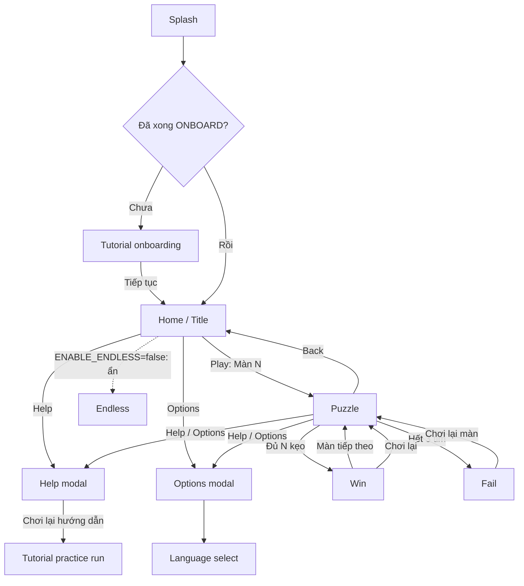

# GDD-04 — UX/UI

| Thuộc tính | Giá trị |
| --- | --- |
| Dự án | CanDoKu |
| Mã tài liệu | GDD-04 |
| Phiên bản | 1.0.0 |
| Trạng thái | Draft · Living document |
| Cập nhật | 2026-10-14 |
| Phụ trách | Game Design |
| Liên quan | [GDD-02](02-core-gameplay.md), [GDD-03](03-game-systems.md), [GDD-06](06-art-direction.md), [GDD-07](07-audio.md), [GDD-08](08-technical-design.md), [GDD-09](09-qa-acceptance.md) |

> **Tóm tắt:** Chương này quyết định luồng màn hình, bố cục HUD màn chơi, cách trình bày phản hồi, FTUE (tutorial bắt buộc, coach L01/L02, contextual tips), danh sách cài đặt, accessibility và localization. Luật và điều khiển ở [GDD-02](02-core-gameplay.md); Hint/Undo/Combo ở [GDD-03](03-game-systems.md).

## 1. Mục đích và phạm vi

- Trong phạm vi: các màn thật trong `game/scripts/screens/` và `game/splash/`, điều hướng `NavController`, HUD, FTUE, settings, accessibility, chuỗi hiển thị.
- Ngoài phạm vi: luật suy luận, thông số hệ thống (xem GDD-02/03), màu và asset (GDD-06), âm thanh (GDD-07).

**Design intent:** điều hướng tuyến tính, ít tầng. Người chơi mở app → học luật một lần → bấm Play là vào đúng màn đang dở. Không có bản đồ chương hay màn chọn level cho người chơi.

## 2. Screen flow

`NavController` quản lý bốn trạng thái `TITLE`, `PUZZLE`, `WIN`, `FAIL`. Help, Options và Language select là modal/overlay mở chồng lên màn gọi và trả về đúng màn đó.

Endless đã được xây dựng nhưng tắt bằng cờ `ENABLE_ENDLESS=false` (`core/game_features.gd`); nút Endless trên Home ẩn, chỉ truy cập qua debug panel. Chi tiết Endless ở [GDD-03](03-game-systems.md).

## 3. Đặc tả từng màn

| ID | Màn | Mục đích | Thành phần chính | Hành động | Thoát | Trạng thái |
| --- | --- | --- | --- | --- | --- | --- |
| UX-00 | Splash (`game/splash/splash_screen.gd`) | Che thời gian boot | Logo CanDoKu, nền `#FFFDF5` | — | Tự chuyển sang Tutorial (lần đầu) hoặc Home | Live |
| UX-01 | Home (`title_screen.gd`) | Điểm vào duy nhất | Logo, mascot + bong bóng thoại, nút Play “Màn N” (hoặc “Chơi lại chiến dịch” khi đã xong), nút tròn Help & Options ở trên, Debug (chỉ bản debug), Endless (ẩn) | Play, Help, Options, chạm mascot | Puzzle / modal | Live |
| UX-03 | Puzzle (`puzzle_screen.gd`) | Màn chơi chính | Xem §4 | Chạm, chạm đôi, vuốt, Undo, Hint, Restart, Back, Help, Options | Home / Win / Fail | Live |
| UX-04 | Tutorial onboarding (`tutorial_screen.gd`) | Dạy luật trước khi chơi | Bàn 4×4 riêng, coach text, bàn tay chỉ dẫn, ô sáng | Theo bước (§6.1) | Home (ghi `ONBOARD`) | Live |
| UX-05 | Win (`win_screen.gd`) | Ăn mừng + dẫn tiếp | Ribbon “Hoan hô!”, tim còn lại, sao trang trí (không chấm điểm), Thời gian + Lỗi sai, thẻ TIẾP THEO (nhãn màn, pill độ khó, N×N) | Màn tiếp theo, Chơi lại | Puzzle | Live |
| UX-06 | Fail (`fail_screen.gd`) | Thua nhẹ nhàng, khuyến khích thử lại | Ribbon “Hết tim rồi!”, badge màn, 0/3 tim, Thời gian, “Suýt nữa là được rồi!” | Chơi lại màn | Puzzle (lượt mới cùng level) | Live |
| UX-07 | Help (`help_screen.gd`) | Tra luật bất kỳ lúc nào | Ba luật, cách điều khiển, tim, nút “Chơi lại hướng dẫn” | Đọc, mở practice run | Màn gọi | Live |
| UX-08 | Options (`options_screen.gd`) | Cài đặt | Lưới 2 cột 6 tile + hàng rộng Tương phản cao + Ngôn ngữ (§7) | Bật/tắt, chọn ngôn ngữ | Màn gọi | Live |
| UX-26 | Language select (`language_select_dialog.gd`) | Chọn 1/7 ngôn ngữ | Danh sách tên ngôn ngữ | Chọn | Options | Live |
| UX-09b | Endless | Chơi vô hạn | Nhãn “Vô tận: Màn %d” | — | Home | Built · tắt bằng flag |

Quy tắc chung:

| ID | Yêu cầu | Tiêu chí kiểm |
| --- | --- | --- |
| UX-15 | Back về Home lưu session ngay, không hỏi; Play mở lại đúng board. | Thoát giữa màn, mở lại → cells/tim/thời gian khớp. |
| UX-25 | Restart luôn hỏi xác nhận “Chơi lại màn này?”; xác nhận reset lượt, hủy giữ board. | Hủy không đổi state; xác nhận reset tim, mark, lỗi. |
| UX-27 | Help/Options là modal có scrim, chặn input bàn, không mất session, đóng về đúng màn gọi. | Mở từ Home và Puzzle, đóng → đúng màn gốc. |

## 4. Puzzle HUD (RST-024)

Bố cục từ trên xuống (theo `puzzle_layout.gd`):

| Vùng | Nội dung | Ghi chú |
| --- | --- | --- |
| Header (safe area) | Back, “Màn n”, Help, Restart, Options | Số màn lấy từ session thật |
| Hàng trạng thái | Hàng kẹo theo vùng (N vị trí, sáng khi vùng đã có kẹo) + 3 tim | Không hiện điểm trong lúc chơi |
| Thẻ luật | 3 thẻ icon + chữ luôn hiện: “1 kẹo mỗi hàng và cột”, “1 kẹo mỗi vùng màu”, “Kẹo không chạm nhau, kể cả chéo” | `RULE_ICON_SIZE`=96, `RULE_FONT_SIZE`=21 |
| Bàn | Ô kẹo 3D, màu vùng trơn, không viền vùng | Ưu tiên diện tích; không zoom/pan |
| Dock | Undo, Hint | Nút Undo luôn hiện (RST-021); Hint không có badge vì không giới hạn |

| ID | Yêu cầu | Tiêu chí kiểm |
| --- | --- | --- |
| UX-03 | HUD gồm đủ các vùng trên; dữ liệu lấy từ session, không số liệu giả. | `test_screens.gd`, QA giao diện. |
| UX-18 | Mục tiêu, chưa kiểm chứng: ô/nút đạt vùng chạm ≥ 44×44 pt trên thiết bị mục tiêu; chưa đo ở mọi N. | Đo trên thiết bị (Track E). |
| UX-21 | Mọi chuỗi qua khóa localization; mục tiêu (chưa kiểm chứng) layout chịu chữ dài +30%, chữ lớn và safe area không chồng lấn. | QA 7 ngôn ngữ. |

Thanh Cheats (`puzzle_debug_bar.gd`) chỉ có khi `OS.is_debug_build()`.

## 5. Trình bày phản hồi

Hành vi input chi tiết ở [GDD-02](02-core-gameplay.md). Bảng dưới chỉ mô tả lớp hiển thị.

| ID | Sự kiện | Trình bày | Tiêu chí kiểm |
| --- | --- | --- | --- |
| UX-09 | Chạm đơn | X hiện/ẩn; commit sau cửa sổ 350 ms hoặc lần chạm kế. Không preview X khi mới chạm xuống. | `test_touch_decoder.gd` |
| UX-10 | Chạm đôi cùng ô | Một `try_candy`; không lưu X trung gian. | `test_touch_decoder.gd` |
| UX-11 | Vuốt (> 12 px) | Chỉ hiện trail khi kéo; mode theo ô đầu (BLANK → vẽ, MARK → xóa); lưu một batch khi nhấc. | `test_play_session.gd` |
| UX-22 | Đa điểm | Chỉ ngón chính bắt đầu trong bàn được xử lý. | QA thiết bị |
| UX-23 | Vuốt nhanh | Nội suy ô trung gian (tối đa 12 ô/span, cho phép chéo); vận tốc > 6000 px/s bị bỏ. | `test_touch_decoder.gd` |
| UX-12 | Kẹo đúng | Hiệu ứng kẹo hé lộ, hàng kẹo vùng sáng, combo voice + word-art popup trên ô (RST-026); nửa chặng (ceil(N/2)) chỉ phát âm `PROGRESS_COMPLETE`, không có chữ. | `test_feedback.gd` |
| UX-13 | Kẹo sai | Ô ERROR (X đỏ có dấu cảnh báo), shake + SFX + haptic, tim cập nhật cùng lúc. Lý do lỗi được tính nhưng không hiển thị; tip C-err xuất hiện lần đầu. | `test_feedback.gd` |
| UX-14 | Hint | Một overlay: thẻ trắng viền vàng, chữ + highlight, scrim spotlight nâu ấm; nút Áp dụng (vàng), Chi tiết (chỉ CONTRA_CHAIN), Đóng. Nhấn Hint khi đang hiện → đóng. | `test_screens.gd` |
| UX-24 | Undo | Hoàn nguyên action X gần nhất (một chạm, một nét, hoặc batch mark từ hint); không áp dụng cho kẹo/lỗi. | `test_play_session.gd` |
| UX-20 | Kênh độc lập | SFX, nhạc, rung tắt riêng; tắt hết vẫn đọc được đúng/sai, tim, màn. | QA |

## 6. FTUE

**Design intent:** dạy mỗi bước một luật, học bằng làm, sau đó rút dần sự dẫn dắt. Ba tầng: onboarding bắt buộc → coach trong L01/L02 → contextual tips từ L03.

### 6.1 Onboarding bắt buộc (RST-028)

Lần đầu mở app, tutorial phủ trước Home, không có nút Bỏ qua. Hoàn tất ghi `ONBOARD` vào `progress.tutorialSeenIds`. Help → “Chơi lại hướng dẫn” mở practice run, không ghi progress.

Bàn 4×4 `ABCC / AACC / AADD / DDDD`, nghiệm `[1,3,0,2]` (`campaign/tutorial_flow.gd`). Bước có hướng dẫn chỉ nhận input trên ô sáng.

| # | Step id | Nội dung (khóa) | Thao tác yêu cầu |
| --- | --- | --- | --- |
| 1 | `place` | `tutorial.s_place` — chạm nhanh 2 lần để đặt kẹo | Chạm đôi ô (0,1) |
| 2 | `regions` | `tutorial.s_regions` — mỗi vùng màu một kẹo | Nút OK |
| 3 | `touch` | `tutorial.s_touch` — kẹo không chạm nhau, kể cả góc | Vuốt qua ô sáng |
| 4 | `rowcol` | `tutorial.s_rowcol` — mỗi hàng/cột một kẹo | Chạm ô sáng |
| 5 | `lone` | `tutorial.s_lone` — vùng chỉ còn một ô | Chạm đôi (1,3) |
| 6 | `hearts` | `tutorial.s_hearts` — 3 tim, sai mất 1 | Nút OK |
| 7 | `last` | `tutorial.s_last` — tìm kẹo còn lại | Chạm đôi tự do; cho phép Hint |
| 8 | `done` | `tutorial.s_done` — pháo giấy | Nút Tiếp tục |

### 6.2 Coach trong level L01/L02

`campaign/tutorial_guide.gd` hiển thị coach bubble trên L01/L02. Mọi bước có nút Bỏ qua, trừ bước đầu của L01. Bước tự bỏ qua khi người chơi đã làm trước hướng dẫn.

### 6.3 Contextual tips (từ L03, mỗi tip một lần)

| Tip ID | Điều kiện | Nội dung |
| --- | --- | --- |
| C-err | Lỗi đầu tiên | `tutorial.tip_error` — X đỏ, mất 1 tim |
| C-heart1 | Còn 1 tim | “Còn 1 tim! Chưa chắc thì dùng Gợi ý.” |
| C-undo | Bấm Undo sau kẹo sai | “Không thể hoàn tác qua lần thử kẹo sai.” |
| C-s3 | Bắt đầu L19 | `tutorial.tip_s3` — mẹo khóa giao thoa |
| C-size5 | Bàn N ≥ 5 đầu tiên | `tutorial.tip_size5` |
| C-idle | 30 s không thao tác, 0 hint | Nút Hint nhún gọi chú ý |

Tip `C-given` đã bỏ cùng cơ chế givens. Trạng thái đã xem lưu trong `progress.tutorialSeenIds`.

| ID | Yêu cầu | Tiêu chí kiểm |
| --- | --- | --- |
| UX-04 | Onboarding bắt buộc 8 bước, không Skip, chỉ hiện một lần; practice run không ghi progress. | `test_screens.gd`, `test_integration.gd` |
| UX-28 | Coach L01/L02 có Skip (trừ bước đầu L01) và auto-skip khi người chơi đi trước. | test tutorial guide |
| UX-29 | Mỗi contextual tip hiện tối đa một lần trên profile. | Kiểm `tutorialSeenIds` |

### 6.4 Tham số FTUE

| Tham số | Giá trị | File nguồn |
| --- | --- | --- |
| Bàn onboarding | `ABCC/AACC/AADD/DDDD`, `[1,3,0,2]` | `campaign/tutorial_flow.gd` |
| ID hoàn tất | `ONBOARD` | `screens/tutorial_screen.gd` |
| Ngưỡng idle | 30 s | `campaign/tutorial_tips.gd` |
| Màn tip S3 | L19 | `campaign/tutorial_tips.gd` |

## 7. Settings

Lưu tại `config.json` v1 (RST-025).

| Key | Nhãn (vi) | Mặc định | Tác dụng |
| --- | --- | --- | --- |
| `music` | Nhạc nền | Bật | BGM |
| `audio` | Âm thanh | Bật | Chỉ SFX |
| `haptic` | Rung phản hồi | Bật | Haptic SOFT/NORMAL/FIRM |
| `reduced_motion` | Giảm chuyển động | Tắt | Thay nhảy/lắc bằng fade ngắn |
| `large_text` | Cỡ chữ lớn | Tắt (key) | Layout hiện dùng chữ lớn mặc định |
| `colorblind` | Hỗ trợ phân biệt màu | Tắt | Phủ họa tiết |
| `high_contrast` | Độ tương phản cao | Tắt | Texture X/viền tương phản cao |
| `language` | Ngôn ngữ | `""` (tự theo hệ thống) | 7 ngôn ngữ |

Profile cũ chưa có `music` lấy giá trị `audio` đã lưu.

## 8. Accessibility

| ID | Yêu cầu | Tiêu chí kiểm |
| --- | --- | --- |
| UX-16 | Màu không mang luật duy nhất. Chế độ colorblind giữ màu, phủ họa tiết lên nửa số vùng tối hơn; vùng kề không trùng họa tiết. X đỏ có dấu cảnh báo. | Kiểm ảnh thang xám. |
| UX-19 | Reduced motion thay nhảy/lắc/flash bằng fade ngắn hoặc trạng thái tĩnh. | QA với toggle bật. |
| UX-30 | High contrast dùng texture X tương phản cao (`CellAnimator.get_mark_texture`). | QA giao diện. |
| UX-31 | Large text không làm chồng lấn header, thẻ luật, bàn, dock. | QA thiết bị nhỏ. |
| UX-17 | Screen reader đọc hàng/cột/vùng/trạng thái, có action “Đánh/Xóa X” và “Tìm kẹo”. | Backlog |

Màu vùng: tô màu đồ thị CIELAB, ΔE76 ≥ 20 giữa vùng kề (chi tiết ở [GDD-06](06-art-direction.md)).

## 9. Localization

- 7 ngôn ngữ: `en`, `ja`, `vi`, `id`, `pt_BR`, `es`, `ko`.
- Nguồn: `game/locale/strings.csv` (~128 khóa, cột `key,en,ja,vi,id,pt_BR,es,ko`).
- Font: BeVietnamPro (heading), Nunito (body), NotoSansCJK subset cho ja/ko.
- Placeholder dùng `%s`, `%d` hoặc `{r}`, `{c}`, `{n}`; người dịch giữ nguyên.

### Key copy (vi)

| Khóa | Chuỗi |
| --- | --- |
| `title.play` | Màn %s |
| `title.replay` | Chơi lại chiến dịch |
| `title.mascot_bubble` | Giải đố cùng mình nhé! |
| `puzzle.rule_row` | 1 kẹo mỗi hàng và cột |
| `puzzle.rule_region` | 1 kẹo mỗi vùng màu |
| `puzzle.rule_diagonal` | Kẹo không chạm nhau, kể cả chéo |
| `puzzle.restart_title` | Chơi lại màn này? |
| `puzzle.restart_body` | Các ô đã đánh dấu và số lỗi của lượt chơi sẽ được đặt lại. |
| `hint.place_candy` / `hint.mark_x` / `hint.detail` | Đặt kẹo / Đánh dấu X / Xem các bước |
| `hint.fallback` | Gợi ý nước đi tiếp theo: đặt một viên kẹo vào ô này. |
| `result.win.title` | Hoan hô! |
| `result.win.next` | Màn tiếp theo |
| `result.win.next_header` | TIẾP THEO |
| `result.stat.time` / `result.stat.mistakes` | Thời gian / Lỗi sai |
| `result.lose.title` | Hết tim rồi! |
| `result.lose.encourage_title` | Suýt nữa là được rồi! |
| `result.lose.retry` | Chơi lại màn |
| `tutorial.s_place` | **Chạm nhanh 2 lần** vào ô để đặt kẹo. |
| `tutorial.s_lone` | Vùng này **chỉ còn một ô**. Kẹo phải ở đó! |
| `tutorial.s_done` | Giỏi lắm! Bạn đã sẵn sàng chơi thật rồi. |
| `help.replay_tutorial` | Chơi lại hướng dẫn |
| `settings.title` | CÀI ĐẶT |

## 10. Planned

Assist inventory (kho trợ giúp, nút đặt kẹo, badge, popup hết lượt, play streak) đang phát triển trên nhánh `feat/v1.0.1/assist-inventory` — Planned, chưa thuộc thiết kế Live. Xem [GDD-03](03-game-systems.md).

## 11. ID đã hủy

| ID | Lý do |
| --- | --- |
| UX-02 | Không có bản đồ/màn chọn level. |

Các yêu cầu cũ về chữ “Tìm thấy rồi!”, hiển thị lý do lỗi cục bộ, nút Hint “Đã dùng”, một Hint/lượt và tip `C-given` không còn hiệu lực; nội dung tương ứng trong UX-12/13/14 đã viết lại theo code.

## 12. Câu hỏi mở và rủi ro

| ID | Vấn đề | Tác động | Hướng xử lý |
| --- | --- | --- | --- |
| Q-04-1 | Chạm ô ở N ≥ 7 chưa đo trên thiết bị | Mis-tap ở campaign_100 | Đo trong Track E QA thiết bị |
| Q-04-3 | Toggle `large_text` còn trong config nhưng layout luôn dùng chữ lớn | Toggle không có tác dụng rõ | Quyết định giữ/bỏ tile |
| Q-04-4 | UX-17 screen reader chưa triển khai | Hạn chế accessibility | Backlog |

## Lịch sử thay đổi

| Phiên bản | Ngày | Thay đổi |
| --- | --- | --- |
| 1.0.0 | 2026-10-14 | Viết lại theo chuẩn GDD; hợp nhất GDD 03 cũ, RST-021/024/025/026/028 và hành vi code hiện hành. |
