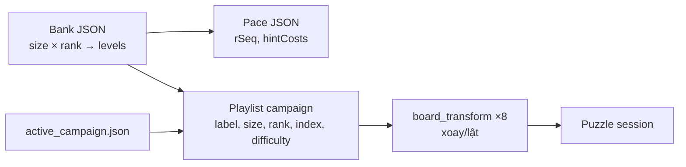

# GDD-05 — Level Design

| Thuộc tính | Giá trị |
| --- | --- |
| Dự án | CanDoKu |
| Mã tài liệu | GDD-05 |
| Phiên bản | 1.0.0 |
| Trạng thái | Draft · Living document |
| Cập nhật | 2026-10-14 |
| Phụ trách | Game Design |
| Liên quan | [GDD-02](02-core-gameplay.md), [GDD-03](03-game-systems.md), [GDD-08](08-technical-design.md), [GDD-09](09-qa-acceptance.md), [GDD-10](10-reasoning-techniques.md), [GDD-11](11-level-generation.md) |

> **Tóm tắt:** Chương này quyết định kiến trúc nội dung (bank → pace → playlist → transform), kho level hiện có, campaign đang chạy, thang độ khó rank 1–5, đường cong độ khó và các cổng chất lượng LV-xx mà mọi level phải qua trước khi vào build.

## 1. Mục đích và phạm vi

- Trong phạm vi: dữ liệu level trong `game/data/banks/` và `game/data/campaigns/`, cách chọn level cho campaign, tiêu chí phát hành, quy trình biên tập.
- Ngoài phạm vi: mô hình toán và kỹ thuật suy luận ([GDD-10](10-reasoning-techniques.md)), pipeline sinh level và rating ([GDD-11](11-level-generation.md)), DDA runtime ([GDD-03](03-game-systems.md)).

**Design intent:** level là tài sản dữ liệu bất biến, đã kiểm chứng offline. Campaign chỉ là danh sách tham chiếu vào bank, nên đổi nhịp chơi không cần đụng puzzle. Mọi level giải được bằng logic, không đoán, không có ô cho sẵn.

## 2. Kiến trúc nội dung

| Lớp | File | Schema | Vai trò |
| --- | --- | --- | --- |
| Size bank | `bank_<N>x<N>.json`, `bank_gc_*`, `bank_lkstyle_*`, `bank_onefish_*` | `{bankVersion, size, ranks: {"1".."5": [level]}}` | Kho puzzle theo kích thước và rank |
| Typed bank | `bank_lk`, `bank_lk_modified`, `bank_single_region`, `bank_sp`, `bank_sp_tt`, `bank_super_hard` | `{bankVersion, type, levels: [level]}` | Kho đặc biệt cho Endless/tier |
| Pace | `<bank>.pace.json` | `{bankVersion, size, pacing: {rank: [{rSeq, hintCosts}]}}` / typed `{bankVersion, type, levels: [...]}` | Thứ tự trong rank; `hintCosts` chỉ được validate, chưa dùng runtime |
| Playlist | `game/data/campaigns/<id>.json` | `{campaignVersion: 1, id, playlist: [{label, size, rank, index, difficulty}]}` | Trình tự campaign |
| Active | `active_campaign.json` | id campaign | Chọn campaign khi khởi động |
| Transform | `board_transform` | 8 phép đối xứng | Tăng đa dạng hình thức, không đổi logic |

Trường level: `seed`, `regions`, `solution`, `givens` (phải rỗng), `steps`, `profile`, `rating`, `pidHash`, `logicTrace`. Typed bank có thêm `id`, `label`, `size`, `rank`, `colorMap`, `pattern`, `spRegion`, `shapeCategory`, `maxRegionFrac`. Schema đầy đủ và mã hóa (XOR qua `tools/encode_banks`) ở [GDD-08](08-technical-design.md).

## 3. Kho level

Tổng: **36.573 level** trong 31 bank (+31 pace).

| Bank | Số level |
| --- | --- |
| `bank_4x4` | 36 |
| `bank_5x5` | 49 |
| `bank_6x6` | 913 |
| `bank_7x7` | 1.929 |
| `bank_8x8` | 2.440 |
| `bank_9x9` | 2.551 |
| `bank_10x10` | 2.504 |
| `bank_11x11` | 1.445 |
| `bank_12x12` | 800 |
| Cộng size bank chính 4–12 | 12.667 |
| Biến thể size bank (`gc` 6/8–12, `lkstyle` 7–12, `onefish` 7–10) | phần còn lại của 36.573 |
| `bank_lk` / `bank_lk_modified` | 169 / 169 |
| `bank_single_region` | 6.196 |
| `bank_sp` / `bank_sp_tt` | 57 / 432 |
| `bank_super_hard` | 275 |

Phân bố rank của bank nhỏ: 4×4 `12/10/8/3/3`, 5×5 `12/10/8/9/10`, 6×6 `199/196/193/167/158` (RST-019). Bank 7–12 chuyển đổi 100% kèm fallback logic trace (RST-020).

## 4. Campaigns

| Campaign | Số màn | Kích thước | Vai trò | Trạng thái |
| --- | --- | --- | --- | --- |
| `campaign_100` | 100 | 4:3, 5:5, 6:8, 7:11, 8:13, 9:14, 10:14, 11:16, 12:16 | Campaign chính | **Active** |
| `demo_30` | 30 | L01–L10 4×4, L11–L20 5×5, L21–L30 6×6 | Playtest/demo (RST-018) | Sẵn sàng |
| `advanced` | 80 | ≥ 7×7 | Mở rộng nâng cao | Sẵn sàng |
| `full_998` | 998 | 4–6 | Phủ toàn bộ bank v1 (RST-019) | Sẵn sàng |
| `demo_cross` | 45 | 4–6 | Chỉ test | Test |

Đổi campaign bằng `active_campaign.json`, có hiệu lực khi khởi động lại. Endless (tắt bằng flag) lấy level trực tiếp từ bank, xem [GDD-03](03-game-systems.md).

## 5. Độ khó và rank

| Rank | Ý nghĩa | Nhãn `difficulty` thường gặp |
| --- | --- | --- |
| 1 | Chuỗi suy luận ngắn, kỹ thuật cơ bản | `tutorial`, `easy` |
| 2 | Chuỗi dài hơn, giao hàng/cột/vùng | `easy`, `medium` |
| 3 | Cần khóa giao thoa/tập con | `medium`, `hard` |
| 4 | Kỹ thuật nâng cao | `hard` |
| 5 | Chuyên gia, có thể cần chuỗi mâu thuẫn | `expert` |

Nhãn hiển thị: Hướng dẫn, Dễ, Trung bình, Khó, Chuyên gia (`difficulty.*`). DDA điều chỉnh rank runtime (trần 2 tới L15, 3 tới L30, sau đó 5) — xem [GDD-03](03-game-systems.md). Rating chi tiết ở [GDD-11](11-level-generation.md).

## 6. Đường cong độ khó

### 6.1 `campaign_100`

| Màn | Kích thước | Rank | Phân bố difficulty |
| --- | --- | --- | --- |
| 1–10 | 4–6 | 1–2 | 2 tutorial, 6 easy, 2 medium |
| 11–20 | 6–7 | 1–3 | 6 easy, 2 medium, 2 hard |
| 21–30 | 7–8 | 1–3 | 4 easy, 3 medium, 3 hard |
| 31–40 | 8 | 1–3 | 3 easy, 4 medium, 3 hard |
| 41–50 | 9 | 1–2 | 6 easy, 4 medium |
| 51–60 | 9–10 | 1–3 | 6 easy, 4 hard |
| 61–70 | 10–11 | 2–3 | 2 easy, 4 medium, 4 hard |
| 71–80 | 11 | 2–3 | 4 easy, 5 medium, 1 hard |
| 81–90 | 11–12 | 2–4 | 6 easy, 4 hard |
| 91–100 | 12 | 2–4 | 5 medium, 5 hard |

Design intent: tăng kích thước làm trục tiến triển chính; khi lên size mới, rank hạ về 1–2 để làm “màn nghỉ” trước khi tăng tải suy luận.

### 6.2 `demo_30`

Mỗi khối 10 màn một kích thước, gồm 5 rank 1, 3 rank 2, 2 rank 3 (L01/L02 là tutorial).

## 7. Cổng chất lượng level

| ID | Yêu cầu | Tiêu chí kiểm |
| --- | --- | --- |
| LV-01 | N = 4–12; đúng N vùng không rỗng, liên thông 4 hướng; mỗi ô đúng một nhãn vùng. | `validate_content.py`, `validate_full_content.py` |
| LV-02 | Đúng một nghiệm; nghiệm khai báo khớp solver độc lập. `givens` phải rỗng. | Validator từ chối givens không rỗng |
| LV-03 | `logicTrace` tái dựng tuần tự đến đủ N kẹo bằng S1–S7 hoặc fallback trace; không bước đoán. | `level_reasoning`, validator |
| LV-04 | Hai level cách nhau ≤ 8 vị trí campaign không trùng hình vùng sau 8 phép đối xứng + đổi nhãn. | Chưa tự động cho `demo_30`/`full_998`/`campaign_100` (`tools/playlist_checks.py` chỉ kiểm cấu trúc); chỉ `GDD/tools/validate_levels.py --release` kiểm cửa sổ 8 màn cho định dạng MVP 24 level |
| LV-05 | Mỗi slot playlist có `label`, `size`, `rank`, `index`, `difficulty` hợp lệ trỏ tới level tồn tại. | `validate_content.py` |
| LV-06 | Vùng, dấu và kẹo đọc được ở thang xám, chữ lớn, màn nhỏ; màu không mang luật duy nhất. | QA giao diện |
| LV-07 | Màn mốc (10, 20, 30…) được biên tập như điểm nhấn nhịp; puzzle/ID đã duyệt là bất biến. | Review biên tập |
| LV-08 | Trình tự kỹ thuật theo band: màn đầu chỉ S1–S2; kỹ thuật cao hơn chỉ xuất hiện sau khi đã có tip/hint tương ứng (vd C-s3 ở L19). | Review biên tập, playtest (`playlist_checks` chưa kiểm trình tự kỹ thuật) |

### Reasoning bands

| Band | Kỹ thuật | Hint tương ứng |
| --- | --- | --- |
| Cơ bản | S1 loại trừ, S2 ứng viên đơn | MARK_NEIGHBORS, SINGLE_CANDIDATE |
| Giao thoa | S3 khóa giao thoa | LOCK_INTERSECTION |
| Tập con | Locked subset cặp/bộ ba/bộ bốn | LOCKED_SUBSET |
| Nâng cao | Chuỗi mâu thuẫn ngắn/dài, fallback | CONTRA_CHAIN, FALLBACK |

Định nghĩa S1–S7, X1–X4 ở [GDD-10](10-reasoning-techniques.md); quy tắc band và `given cap 0` ở `GDD/tools/bank_expansion_rules`.

## 8. Quy trình biên tập

1. **Nguồn:** sinh/chuyển đổi bằng công cụ trong `GDD/tools/` và `tools/` ([GDD-11](11-level-generation.md)). Không lấy bố cục từ game thương mại.
2. **Kiểm máy:** uniqueness, liên thông, trace, givens rỗng (LV-01–03).
3. **Lọc trùng:** chuẩn hóa ×8 và kiểm cửa sổ 8 màn (LV-04) — hiện chưa tự động cho playlist của game, cần kiểm tay.
4. **Xếp playlist:** chọn `size/rank/index` theo đường cong §6; chạy `playlist_checks` (kiểm cấu trúc).
5. **Giải mù (dự kiến, chưa thực hiện — chưa có bằng chứng):** ít nhất một lượt giải thủ công không xem nghiệm; ghi thời gian, số hint, điểm kẹt.
6. **Gate:** `tools/verify.py` (full gate) trước merge; playtest ở [GDD-09](09-qa-acceptance.md).

Level không qua cổng thì thay, không hạ tiêu chuẩn để đủ số lượng.

## 9. Tham số

| Tham số | Giá trị | File nguồn |
| --- | --- | --- |
| Campaign active | `campaign_100` | `game/data/campaigns/active_campaign.json` |
| Số rank | 5 | bank JSON |
| Phép biến đổi | 8 | `board_transform` |
| Cửa sổ chống trùng | 8 màn (chưa tự động cho playlist game) | `GDD/tools/validate_levels.py --release` (chỉ MVP 24 level) |
| Given cap | 0 | `GDD/tools/bank_expansion_rules` |

## 10. ID đã hủy

Không có. LV-02, LV-03, LV-05, LV-08 đã viết lại cho phạm vi N = 4–12 và chính sách không givens.

## 11. Câu hỏi mở và rủi ro

| ID | Vấn đề | Tác động | Hướng xử lý |
| --- | --- | --- | --- |
| Q-05-1 | `hintCosts` trong pace chưa dùng runtime | Dữ liệu thừa | Dùng khi assist inventory (Planned) chốt, hoặc bỏ |
| Q-05-2 | `campaign_100` chưa có playtest người thật cho N ≥ 7 | Đường cong chưa kiểm chứng | Track E playtest |
| Q-05-3 | Bank 7–12 phụ thuộc fallback trace cho bài S4+ | Hint có thể rơi vào FALLBACK | Theo dõi tỉ lệ FALLBACK trong playtest |

## Lịch sử thay đổi

| Phiên bản | Ngày | Thay đổi |
| --- | --- | --- |
| 1.0.0 | 2026-10-14 | Viết lại theo chuẩn GDD; hợp nhất GDD 04 cũ, RST-018/019/020 và dữ liệu bank/campaign hiện hành. |
