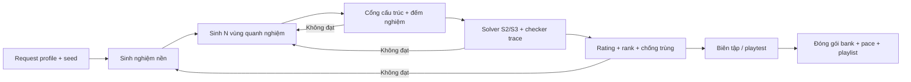

# GDD-11 — Appendix B: Sinh level và đánh giá độ khó

| Thuộc tính | Giá trị |
| --- | --- |
| Dự án | CanDoKu |
| Mã tài liệu | GDD-11 |
| Phiên bản | 1.0.0 |
| Trạng thái | Approved · Living document |
| Cập nhật | 2026-10-14 |
| Phụ trách | Game Design · Level Design · Tools |
| Liên quan | [GDD-02](02-core-gameplay.md), [GDD-03](03-game-systems.md), [GDD-05](05-level-design.md), [GDD-08](08-technical-design.md), [GDD-09](09-qa-acceptance.md), [GDD-10](10-reasoning-techniques.md), [GDD-12](12-glossary.md) |

> **Tóm tắt:** Phụ lục này đặc tả pipeline offline tạo level CanDoKu: hồ sơ yêu cầu, sinh nghiệm và vùng, cổng uniqueness/trace, mô hình độ khó (rating-0, rank, `max_technique`), chống trùng, hiệu chỉnh bằng người chơi và hợp đồng đầu ra. Mọi level có `givens` rỗng. Mỗi mục ghi rõ phần Live (đã có công cụ) và Research.

## 1. Mục đích và phạm vi

- Là đặc tả cho công cụ offline trong `GDD/tools/` và `tools/`, và cho người/AI tạo ứng viên level.
- **Không có sinh level runtime.** Game chỉ đọc bank đã đóng gói ([GDD-05](05-level-design.md), [GDD-08](08-technical-design.md)).
- Kỹ thuật suy luận và ký hiệu (K, E, P, S1–S7) theo [GDD-10](10-reasoning-techniques.md).

### 1.1. Bốn lớp chất lượng của một level

| Lớp | Tiêu chí | Kiểm bởi |
| --- | --- | --- |
| Đúng | N vùng liên thông, nghiệm duy nhất kiểm độc lập, `givens` rỗng | Validator (máy) |
| Giải thích được | Giải trọn bằng ruleset cho phép, trace có chứng cứ, không đoán | Solver + checker (máy) |
| Vừa sức | Khớp rank/band mục tiêu | Rating + biên tập + playtest |
| Đáng chơi | Không trùng, vùng dễ đọc, có nhịp phát hiện | Diversity filter + biên tập |

Có một nghiệm không chứng minh duy nhất. Trace có S3 không chứng minh S3 bắt buộc. Máy giải nhanh không chứng minh người chơi thấy dễ.

## 2. Pipeline



| Thành phần | Trách nhiệm | Trạng thái |
| --- | --- | --- |
| Request/profile | Số lượng, N, logic band, seed, budget | Live (profile CLI của `generate_levels.py`) |
| Solution generator | Hoán vị cột thỏa không-kề | Live |
| Region generator | N vùng liên thông, mỗi vùng chứa một ô nghiệm | Live |
| Exact checker | Đếm tới 2 nghiệm, UNIQUE/MULTIPLE/INVALID/UNKNOWN | Live (`validate_levels.count_solutions`) |
| Human-style solver | Closure S2/S3 không đọc nghiệm, xuất trace | Live (`level_reasoning.solve`) |
| Proof checker | Kiểm lại từng bước trace | Live (`validate_levels.py`) |
| Difficulty analyzer | Vector + rating-0 | Live (`level_reasoning.py`) |
| Runtime replay | `replay_solve` S1–S7, `profile`, `max_technique` | Live (GDScript) |
| Diversity filter | Canonical geometry/puzzle key | Live; LogicPattern là Research |
| Mutation vùng | Chuyển ô biên giữa vùng để sửa ứng viên | Research |
| Content packager | Bank schema v1 + pace + playlist | Live |

Exact checker và proof checker độc lập với generator: dùng chung parser được, nhưng không dùng `solution` khai báo để bỏ qua kiểm.

## 3. Request profile

Profile là đầu vào công cụ, **không** thêm vào schema level.

```json
{
  "requestVersion": 1,
  "profileId": "candoku-s3-pilot",
  "count": 6,
  "sizes": [5, 6],
  "allowedTraceRules": ["S2", "S3"],
  "requireS3": true,
  "maxGivens": 0,
  "seed": "candoku-content-0001",
  "ratingVersion": "candoku-rating-0",
  "maxAttempts": 5000,
  "maxWallSeconds": 600,
  "exactMaxNodesPerAttempt": 2000000,
  "exactMaxSecondsPerAttempt": 5
}
```

| Quy tắc | Nội dung |
| --- | --- |
| `count` | Số ứng viên **đạt**, không phải số lần thử. Hết budget trả số đạt thực và lý do thiếu |
| `maxGivens` | Luôn 0. Parser từ chối giá trị khác (`bank_expansion_rules.BANDS` đặt trần given = 0 cho mọi rank) |
| Từ chối | `count ≤ 0`, N ngoài 4..12, `requireS3` nhưng ruleset thiếu S3 |
| Tái lập | Seed + phiên bản PRNG/generator + profile + thứ tự xử lý. Không dùng hash ngôn ngữ, thời gian hệ thống hay thứ tự duyệt set làm bộ phá hòa |
| Budget | Mỗi `attemptIndex` tái lập cùng ứng viên trước kiểm; tập accepted chỉ cam kết giống nhau khi cùng danh sách attempt đã kiểm xong và không timeout |

## 4. Sinh nghiệm và vùng

### 4.1. Nghiệm nền

```text
ở hàng r:
    xáo các cột chưa dùng theo PRNG
    nếu r > 0: bỏ cột c có |c − s[r−1]| ≤ 1
    chọn c, sang hàng kế; ngõ cụt thì quay lui
đủ N hàng → nghiệm nền s[0..N−1]
```

Nghiệm nền chưa phải level: một hoán vị có vô số cách phân vùng. Không tráo hàng/cột tùy ý (phá không-kề). Xoay/lật toàn bàn là phép tương đương, không tính là nội dung mới.

### 4.2. N vùng liên thông

1. Mỗi ô (r, s[r]) là hạt giống của một vùng.
2. Frontier của vùng = ô chưa gán, chung cạnh với vùng.
3. Chọn cặp (vùng, ô frontier) theo PRNG và tiêu chí hình dạng; gán ô.
4. Lặp tới khi mọi ô được gán; không gán hạt giống của vùng khác.
5. Chuẩn hóa nhãn `A..` theo thứ tự quét hàng.

Kiểm lại liên thông bằng BFS độc lập. Hàm chọn có thể phạt chu vi lớn, nhánh hẹp và lệch diện tích. Vùng một ô tạo S2 ngay từ đầu; nhiều vùng một ô làm level gần như tự giải — đây là đặc tính độ khó, không phải lỗi dữ liệu.

**Mutation (Research):** chỉ chuyển ô biên không phải ô nghiệm sang vùng kề; vùng cho phải còn liên thông và không rỗng. Mọi mutation làm mất hiệu lực uniqueness, trace và rating trước đó.

### 4.3. Không có givens

Mọi kẹo do người chơi tìm. Khi ứng viên có nhiều nghiệm hoặc không đạt band, công cụ **sửa hoặc bỏ topology vùng**, không thêm given. Ưu tiên sửa: độ đọc vùng → uniqueness → logic band → tải suy luận → đa dạng.

## 5. Cổng uniqueness và trace

| Cổng | PASS khi | Khi không đạt |
| --- | --- | --- |
| Cấu trúc | N, nhãn, vùng liên thông, `solution` trong miền, `givens = []` | Loại ứng viên |
| Nghiệm | EXACT không đọc `solution` chứng minh đúng một nghiệm, khớp nghiệm nền | MULTIPLE/INVALID loại; UNKNOWN giữ chưa duyệt |
| Logic | Closure ruleset cho phép giải hết | STUCK: đổi ứng viên/profile |
| Trace | Checker xác nhận mọi bước từ trạng thái trước | Loại trace |
| Cần S3 | Closure S2-only STUCK và S2/S3 SOLVED | S2-only SOLVED → không dùng cho band cần S3 |
| Nội dung | Không trùng theo policy; vùng dễ đọc | Biên tập hoặc sinh lại |
| Người chơi | Giải mù + review Hint/UI | Chưa đủ điều kiện phát hành |

Budget mặc định của bộ đếm: 2.000.000 nút, 5 giây. Đây là ngân sách kiểm, không phải ngưỡng độ khó. Một nghiệm rồi timeout vẫn là UNKNOWN. Trace lưu thứ tự chứng minh, không phải danh sách ô lấy từ `solution` rồi gắn rule.

**Bank N≥7 (chuyển đổi):** bank 7×7–12×12 và các bank typed được chuyển đổi bằng `tools/convert_extracted_bank.py`; khi solver S2/S3 offline không giải trọn, level giữ **fallback logic trace** và `rating` dự phòng. Độ khó thực tế của các level này đo bằng `replay_solve` (S1–S7) ở runtime/test.

## 6. Mô hình độ khó

### 6.1. Bốn thành phần

| Thành phần | Câu hỏi | Chỉ số |
| --- | --- | --- |
| Logic | Cần kỹ thuật nào? | LowestProvenTier, `max_technique`, cần S3 hay không |
| Tải suy luận | Bao nhiêu bước, nhớ bao nhiêu tiền đề? | `ruleCounts`, proofDepth, chuỗi loại trước khi đặt |
| Tìm bước / đọc bàn | Có dễ thấy bước tiếp? | bottleneckCount, maxVisibleCells, hình vùng |
| Trải nghiệm thật | Người chơi mất bao lâu, kẹt ở đâu? | Thời gian, mistakes, hints_used, bỏ cuộc |

Giữ các thành phần tách biệt. Màn S2 dài có thể lâu hơn màn S3 ngắn; S3 không tự thành "hard". Bàn khó nhìn phải sửa hình thức, không coi là thử thách logic.

### 6.2. Tier logic

| Tier | Ruleset | Dùng cho |
| --- | --- | --- |
| B | S1/S2 | Rank thấp 4×4–6×6 |
| I | S1–S3 | Band cần S3 |
| A | S4–S7 | Bank N≥7, typed bank khó; chỉ đo bằng `replay_solve` |
| UNKNOWN | Hết budget hoặc ruleset chưa giải | Không đồng nghĩa Hard |

LowestProvenTier = tier thấp nhất mà closure SOLVED; tier thấp hơn phải STUCK sau duyệt đủ (không timeout).

### 6.3. Difficulty vector (Live trong `level_reasoning.py`)

| Trường | Cách đo |
| --- | --- |
| `ruleCounts` | Số bước S2, S3 trên trace tham chiếu; S1 không tính bước |
| `placedCount` | Số bước đặt; phải bằng N |
| `eliminatedCount` | Số ô mới vào E; không đếm trùng |
| `proofDepth` | Đường phụ thuộc dài nhất; cạnh A→B chỉ khi B dùng kết luận A trong chứng cứ đã chọn |
| `maxVisibleCells` | Số ô cần chỉ ra để giải thích một bước |
| `bottleneckCount` | Số trạng thái chỉ có đúng một hành động hợp lệ |
| `policy` | Một trong `evidence-first-v1`, `coordinate-first-v1`, `reverse-coordinate-v1` |
| `proofStatus` | SOLVED / STUCK / UNKNOWN / INVALID |

Đường tham chiếu là **deterministic**, không phải ngắn nhất. Chạy cả ba policy để đo độ nhạy theo thứ tự; chênh lệch lớn cần biên tập.

### 6.4. Rating-0

```text
D_raw = count(S2) + 4·count(S3) + 2·bottleneckCount + proofDepth + ceil(maxVisibleCells / 6)
```

- Chỉ áp cho tier B/I với trace đầy đủ; thiếu chỉ số → `D_raw = null`.
- Là heuristic chưa hiệu chỉnh; không có thang 0–100; không hiển thị trên UI.
- Không liên quan công thức điểm nội bộ của session.
- Kỹ thuật S4–S7 cần `ratingVersion` mới, không cộng trọng số tùy tiện vào rating-0.

### 6.5. Rank và band

Bank theo kích thước chia `ranks` "1".."5". `rank_for(size, rating, s3_count)` gán rank theo trần rating:

| N | Rank 1 | Rank 2 | Rank 3 | Rank 4 | Rank 5 |
| --- | --- | --- | --- | --- | --- |
| 4 | ≤10 | ≤14 | ≤19 | ≤26 | >26 và có S3 |
| 5 | ≤10 | ≤14 | ≤28 | ≤34 | >34 và có S3 |
| 6 | ≤10 | ≤14 | ≤24 | ≤31 | >31 và có S3 |

Nguồn: `GDD/tools/bank_expansion_rules.py`. Ứng viên vượt trần rank 4 mà không có S3 bị loại. Pace sidecar sinh từ trace: `rSeq` = 1 cho bước S2, 2 cho bước S3 (`pace_from_trace`). Rank được DDA dùng ở runtime ([GDD-03](03-game-systems.md)).

Nhãn `difficulty` trong playlist (`tutorial`, `easy`, `medium`, `hard`…) là nhãn biên tập; validator chỉ kiểm enum, không chứng nhận độ khó.

## 7. Độ đọc vùng và đa dạng

| Lớp | Định nghĩa | Trạng thái |
| --- | --- | --- |
| GeometryKey | Vùng chuẩn hóa dưới 8 phép xoay/lật + đổi nhãn | Live (validator; `shape_fingerprint` runtime) |
| PuzzleKey | `puzzle_key(rows, givens)` chuẩn hóa toàn bộ puzzle; với givens rỗng tương đương GeometryKey | Live; `pidHash` = 8 ký tự đầu |
| Cửa sổ playlist | Không cùng hình vùng trong 8 level liền kề | Live (QA-06) |
| LogicPattern | Chuỗi rule, đồ thị phụ thuộc, vị trí single đầu | Research |
| VisualVector | Diện tích min/max, articulation cells, chu vi/diện tích | Research |

Màu, tên kẹo và đảo nhãn không tạo đa dạng logic. Runtime còn tránh lặp hình gần đây qua `progress.recentShapes` và Endless `recent_hashes` ([GDD-03](03-game-systems.md)).

## 8. Hiệu chỉnh bằng người chơi

Ngưỡng rating và thời gian mục tiêu là giả thuyết cho tới khi có dữ liệu CanDoKu thật.

1. Chọn tập pilot trải tier B/I, N=4–6, nhiều mức `D_raw` và hình vùng.
2. Pilot 3–5 người để bắt lỗi hiểu luật/input.
3. Vòng hiệu chỉnh ≥10 người mục tiêu mỗi ứng viên, xáo thứ tự chơi.
4. Ghi mỗi lượt: mã ẩn danh, kinh nghiệm, revision/`pidHash`, thời gian active, hoàn thành/bỏ cuộc, mistakes, hints_used, bước kẹt.
5. Báo số mẫu, completion rate, hint rate, median/p75 thời gian của lượt không Hint; nhóm còn lại báo riêng.
6. So thứ hạng máy với dữ liệu người; điều tra cặp máy xếp dễ nhưng người thấy khó.
7. Chỉnh trọng số trên tập hiệu chỉnh, kiểm trên tập giữ lại (không dùng biến thể xoay/lật của cùng puzzle ở cả hai tập).
8. Đổi `ratingVersion` và chấm lại kho; không đổi ID/puzzle đã phát hành.

Không thu analytics mạng. Nếu nguyên nhân thua là đọc vùng khó hoặc nhầm double tap, sửa UX, không tăng nhãn logic. Ngưỡng playtest chung ở [GDD-09 §5](09-qa-acceptance.md#5-playtest).

## 9. Vòng tìm kiếm có ngân sách

```text
accepted = []
for attemptIndex in 0..maxAttempts−1:
    nếu hết wall budget: dừng, báo thiếu
    nghiệm nền ← seed dẫn xuất
    vùng ← sinh quanh nghiệm
    kiểm cấu trúc + uniqueness   (UNKNOWN → ghi budget failure)
    closure + checker trace; kiểm band
    rating + rank + chống trùng so kho và accepted
    nếu đạt: lưu level + report
    nếu đủ count: dừng
trả accepted, rejected-summary, unmet-requirements
```

`expand_bank.py` chạy vòng này có checkpoint để tiếp tục. Không tự tăng budget vô hạn, không bỏ uniqueness để đủ số, không âm thầm hạ profile. Cổng cứng: luật, uniqueness, band. Độ khó, đa dạng, độ đọc là lựa chọn trong tập đã hợp lệ — không dùng tổng điểm cho phép hình đẹp bù cho nhiều nghiệm.

## 10. Hợp đồng đầu ra

### 10.1. Level trong bank (schema v1)

| Trường | Nội dung |
| --- | --- |
| `seed` | Định danh attempt |
| `regions` | N chuỗi nhãn |
| `solution` | `solution[r] = c` |
| `givens` | Luôn `[]` |
| `steps` | Số bước trace |
| `profile` | `[count S2, count S3, count S4+]` |
| `rating` | `D_raw` (hoặc giá trị dự phòng với bank chuyển đổi) |
| `pidHash` | 8 ký tự đầu của PuzzleKey |
| `logicTrace` | Các bước S2/S3 như [GDD-10 §6.1](10-reasoning-techniques.md#61-ví-dụ-trọn-bàn-fixture-s301) |

Bank typed bổ sung `id`, `label`, `size`, `rank`, `colorMap`, `pattern`, `spRegion`, `shapeCategory`, `maxRegionFrac`. Schema đầy đủ ở [GDD-08](08-technical-design.md).

### 10.2. Báo cáo sidecar

Ghi tách khỏi bank: request, seed, phiên bản công cụ, `attemptIndex`, exact status/budget, proof status, policy, vector, rating, fingerprint, kết quả review/playtest, lệnh đã chạy và exit code. Mục chưa thực hiện ghi `NOT_RUN`, không ghi PASS mẫu.

### 10.3. Trạng thái nội dung

| Trạng thái | Nghĩa |
| --- | --- |
| CANDIDATE | Mới sinh, chưa qua cổng máy |
| MACHINE_VALIDATED | Qua toàn bộ cổng máy §5 |
| RELEASE_REVIEWED | Qua biên tập, playtest, UI và cổng campaign |

## 11. Công cụ

### 11.1. `GDD/tools/`

| Script | Chức năng | Lệnh |
| --- | --- | --- |
| `validate_levels.py` | Validator schema level + uniqueness + trace S2/S3 | `python -B GDD/tools/validate_levels.py GDD/data/levels.sample.json` |
| `level_reasoning.py` | Closure S2/S3 không đọc nghiệm, vector, rating-0, PuzzleKey | Thư viện |
| `generate_levels.py` | Generator pilot có giới hạn (N=4–6), không ghi campaign live | `python -B GDD/tools/generate_levels.py --out scratch/level-pilot [--size 5] [--profile p.json]` |
| `run_generation_experiment.py` | Lặp pilot qua nhiều seed, báo cả thất bại | `python -B GDD/tools/run_generation_experiment.py --seeds 20 --out scratch/exp` |
| `pilot_report.py` | Báo cáo biên tập + phiếu playtest giấy không lộ nghiệm | Thư viện |
| `bank_expansion_rules.py` | Bands, `rank_for`, `pace_from_trace`, trần given = 0 | Thư viện |
| `expand_bank.py` | Mở rộng bank 4–6 xác định, có checkpoint | `python -B GDD/tools/expand_bank.py --size 6 --bank <bank> --pace <pace> --checkpoint <ckpt> --seed <s> --max-attempts <n>` |
| `build_playtest_bank.py` | Dựng bank/pace/playlist playtest 4–6 | `python -B GDD/tools/build_playtest_bank.py --size 5 --output game/data/banks/bank_5x5.json` |
| `convert_to_bank.py` | Đổi level generator sang bank schema v1 | `python -B GDD/tools/convert_to_bank.py --size <N> --output <bank>` |
| `generate_pace.py` | Sinh pace sidecar từ bank | `python -B GDD/tools/generate_pace.py --bank <bank> --output <pace>` |
| `build_full_campaign.py` | Ghép prefix demo + mọi bộ ba bank thành campaign đầy đủ | `python -B GDD/tools/build_full_campaign.py --demo <demo> --banks <dir> --output <out>` |

Unit test: `python -B -m unittest discover GDD/tools -p "test_*.py"`.

### 11.2. `tools/`

| Script | Chức năng |
| --- | --- |
| `convert_extracted_bank.py` | Chuyển dữ liệu tham chiếu đã trích xuất sang bank v1 + pace (`--type regular/lkstyle/sp/all`, `--all`, `--fast`) |
| `validate_content.py` | Validator bank, pace, playlist |
| `validate_full_content.py` | Chứng minh toàn bộ bank + coverage `full_998` |
| `playlist_checks.py` | Kiểm cấu trúc playlist và tham chiếu bank |
| `endless_coverage_report.py` | Báo cáo coverage bank/pool cho Endless |
| `encode_banks.py` | XOR-encode bank cho release (`--input`, `--output`) |
| `verify.py` | Full gate ([GDD-09 §2](09-qa-acceptance.md#2-chiến-lược-kiểm-thử)) |

### 11.3. Ranh giới nguyên gốc

Mọi topology, nghiệm và trace phải là sản phẩm của pipeline này hoặc của biên tập viên. Không lấy level, ảnh chụp hay đáp án của game thương mại rồi xoay/lật để gọi là level gốc. Ghi chú pháp lý ở [GDD-12](12-glossary.md).

## 12. Mẫu yêu cầu giao người/AI tạo ứng viên

```text
Tạo [số lượng] ứng viên level gốc cho CanDoKu.
Đọc GDD-02, GDD-05, GDD-10, GDD-11 trước khi tạo.

Yêu cầu:
- N=[...], đúng N vùng liên thông 4 hướng, mỗi vùng chứa một ô nghiệm.
- Một kẹo mỗi hàng/cột/vùng; không hai kẹo kề nhau (kể cả góc).
- givens = [] (bắt buộc).
- Trace chỉ dùng [S2 | S2,S3]; S1 là loại tự động.
- [Có/không] yêu cầu S3 cần thiết: báo kết quả closure S2-only.
- Rank mục tiêu [...]; ghi riêng giá trị đo và nhãn biên tập.
- Không trùng hình vùng với kho đính kèm (xét xoay/lật/đổi nhãn).
- Seed [...], budget [...]; thiếu số lượng phải báo thật.

Đầu ra: bank schema v1, sidecar theo GDD-11 §10.2, kết quả chạy validator
và các mục NOT_RUN. Không dùng solution làm chứng cứ suy luận; không tự
tuyên bố đã chạy validator khi không có môi trường chạy.
```

Ứng viên chưa chạy qua công cụ trong repo giữ trạng thái CANDIDATE.

## 13. Live và Research

| Live | Research / Backlog |
| --- | --- |
| Generator pilot N=4–6, closure S2/S3, vector, rating-0, 3 policy | Mutation vùng, tối ưu trace toàn cục |
| Expand bank có checkpoint, rank bands, pace từ trace | Rating cho S4–S7 (`ratingVersion` mới) |
| EXACT counter có budget | LogicPattern / VisualVector |
| Canonical GeometryKey/PuzzleKey | Hiệu chỉnh bằng dữ liệu người chơi |
| Chuyển đổi bank N=7–12 + fallback trace | Sinh level runtime cho Endless |
| `replay_solve` S1–S7 cho đo độ khó runtime | Schema trace cho S4–S7 |

## 14. Câu hỏi mở và rủi ro

| ID | Vấn đề | Tác động | Hướng xử lý |
| --- | --- | --- | --- |
| R-11-01 | Bank N≥7 dùng fallback trace và rating dự phòng | Rank N≥7 chưa phản ánh tải suy luận đo được | Chấm lại bằng `replay_solve` và `ratingVersion` mới |
| R-11-02 | Ngưỡng rating-0 chưa hiệu chỉnh bằng người chơi | Rank có thể lệch cảm nhận | Chạy vòng §8 sau playtest G4 |
| R-11-03 | `hintCosts` trong pace được sinh và validate nhưng runtime không dùng | Dữ liệu thừa, dễ hiểu nhầm | Quyết định giữ cho assist inventory (Planned) hoặc bỏ |

## 15. Tham khảo

- Pelánek, *Difficulty Rating of Sudoku Puzzles by a Computational Model*, FLAIRS 2011 — nguyên tắc đo độ phức tạp bước và phụ thuộc giữa bước; công thức rating-0 là giả thuyết riêng của CanDoKu.
- Espasa et al., 2021 — sinh giải thích từ chứng cứ ràng buộc.

## Lịch sử thay đổi

| Phiên bản | Ngày | Thay đổi |
| --- | --- | --- |
| 1.0.0 | 2026-10-14 | Viết lại theo chuẩn GDD; hợp nhất GDD 11 cũ; givens = 0, bổ sung rank bands, tool inventory thực, đánh dấu Live/Research |
