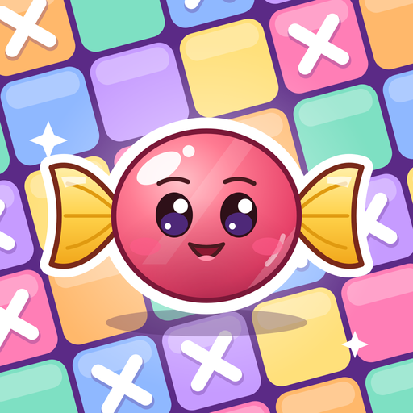

<p align="center">
  
</p>

<h1 align="center">CanDoKu</h1>

<p align="center"><b>Mỗi hàng một viên kẹo. Mỗi cột một viên kẹo. Mỗi vùng màu một viên kẹo.<br>Không cần đoán — chỉ cần suy luận.</b></p>

---

CanDoKu là game giải đố logic 2D chơi offline. Những viên kẹo đang trốn sau các ô màu trên bàn, và nhiệm vụ của bạn là tìm ra tất cả. Mỗi gợi ý đều nằm ngay trên bàn: một hàng đã có kẹo, một vùng màu chỉ còn hai ô trống, một góc bị chặn bởi viên kẹo bên cạnh… Ghép chúng lại, và lời giải sẽ dần hiện ra.

## 🍬 Luật chơi

Chỉ có ba luật:

1. **Mỗi hàng** có đúng một viên kẹo.
2. **Mỗi cột** có đúng một viên kẹo.
3. **Mỗi vùng màu** có đúng một viên kẹo.

Và một điều kiện: **hai viên kẹo không bao giờ chạm nhau**, kể cả chạm góc.

## 👆 Điều khiển

| Thao tác | Kết quả |
|---|---|
| Chạm một lần | Đánh hoặc xóa dấu **X** (ghi chú ô không có kẹo) |
| Kéo từ ô trống | Đánh X hàng loạt |
| Kéo từ ô có X | Xóa X hàng loạt |
| Chạm đôi | Thử tìm kẹo ở ô đó |

Đoán đúng, viên kẹo hiện ra. Đoán sai, bạn mất một ❤️ và ô đó bị khóa bằng **X đỏ** cho đến hết lượt.

## ❤️ Tim, gợi ý và làm lại

- Mỗi lượt có **3 tim**. Hết tim? Cứ thử lại.
- **Hint** không giới hạn, và không chỉ đưa đáp án mà còn giải thích *vì sao* — để lần sau bạn tự thấy.
- **Undo** hoàn tác thao tác X gần nhất, **Restart** bắt đầu lại màn.

Tìm đủ kẹo để hoàn thành màn; điểm của bạn hiện ở màn kết quả.

## 🧩 Thiết kế màn chơi

- **Một lời giải duy nhất** cho mỗi màn — luôn có thể giải bằng logic.
- **Độ khó tăng dần**, từ những bước suy luận đầu tiên đến các thế cờ cần kết hợp nhiều manh mối.
- **Bàn từ 4×4 đến 12×12**, với vùng màu đủ mọi hình dạng.

Mẹo: khi bí, hãy nhìn vào hình dạng vùng màu và những ô bạn đã loại trừ — bước tiếp theo thường nằm ở đó.

## ▶️ Chạy game

Mở `game/project.godot` bằng **Godot 4** rồi nhấn **F5**, hoặc chạy từ thư mục gốc:

```bash
godot --path game
```

## 📚 Tài liệu

- [GDD](GDD/README.md) — tài liệu thiết kế game
- [Luật chơi chi tiết](GDD/02-core-gameplay.md)
- [Kỹ thuật suy luận](GDD/10-reasoning-techniques.md)
